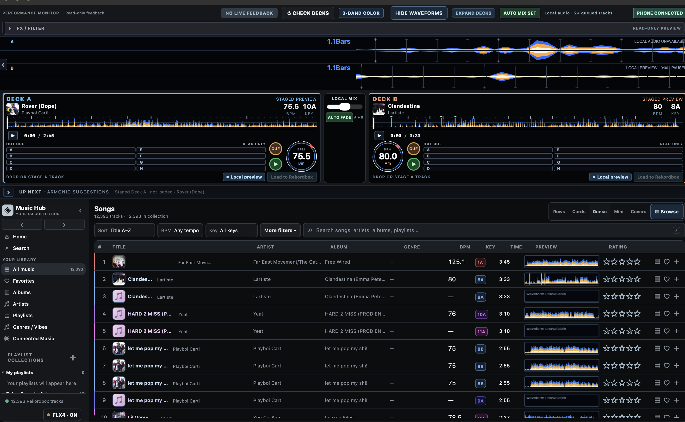
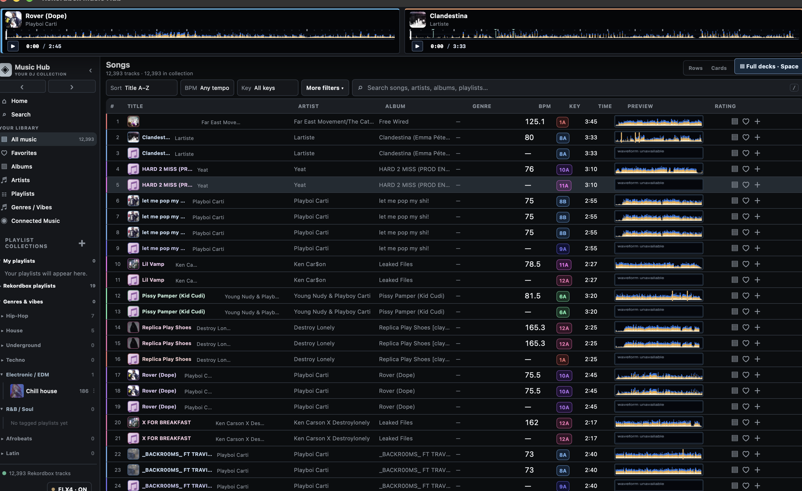
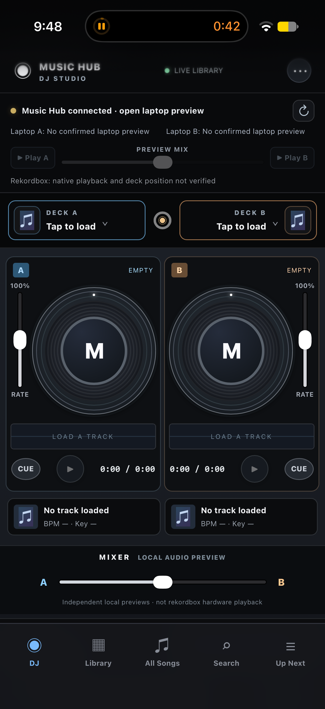
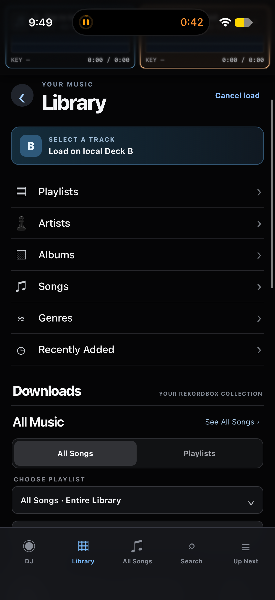
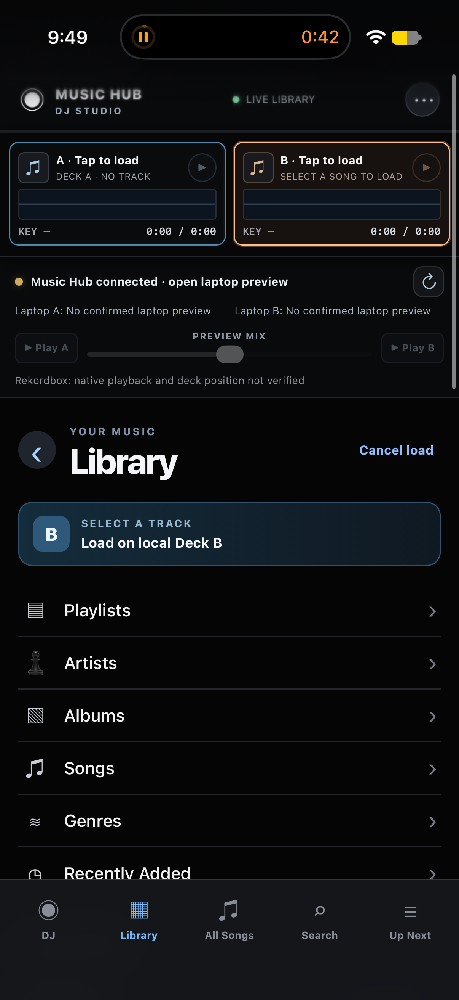
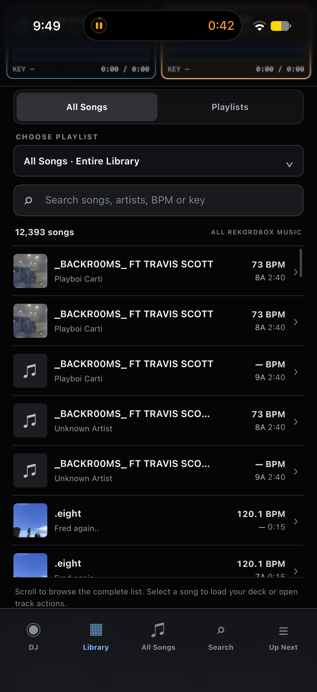
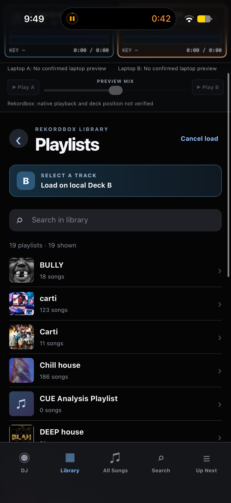
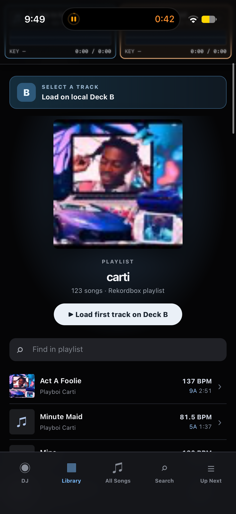

# Music Hub

A local DJ library and performance-planning workspace with a web frontend, Python service components, optional Rust audio modules, and a macOS Swift wrapper.

Music Hub is a **source release for developers**. The UI and its static code can be inspected independently, while music-library integration, installed-app parity and physical controller feedback still require local setup and further verification.

## Music Hub on MacBook and iPhone

These **eight screenshots from November 14, 2026** show the actual Music Hub interface in use: two MacBook captures and six iPhone companion views. The Mac library displays 12,393 indexed tracks, while the phone shows deck targeting, song and playlist browsing, and an individual playlist. All images are from the running local UI, with original pixels preserved and embedded photo metadata removed before publication. Click an image to inspect it at full resolution.

### MacBook · performance and music library

[](docs/screenshots/live-2026-11-14/mac-dj-performance-and-library.png)

*Performance monitor, decks A/B, local preview, mixer, expanded waveforms, compact FLX4 status control and song library.*

[](docs/screenshots/live-2026-11-14/mac-song-library.png)

*Full-library view with track metadata, album, BPM, key, previews, and playlist navigation.*

### iPhone · DJ companion and library

<table>
<tr><td align="center"><a href="docs/screenshots/live-2026-11-14/iphone-dj-decks.png"></a><br /><strong>DJ decks and mixer</strong></td><td align="center"><a href="docs/screenshots/live-2026-11-14/iphone-library-home.png"></a><br /><strong>Library categories</strong></td><td align="center"><a href="docs/screenshots/live-2026-11-14/iphone-deck-b-library.png"></a><br /><strong>Choose a deck</strong></td></tr>
<tr><td align="center"><a href="docs/screenshots/live-2026-11-14/iphone-all-songs.png"></a><br /><strong>All songs and search</strong></td><td align="center"><a href="docs/screenshots/live-2026-11-14/iphone-playlists.png"></a><br /><strong>Playlist browser</strong></td><td align="center"><a href="docs/screenshots/live-2026-11-14/iphone-playlist-detail.png"></a><br /><strong>Playlist details</strong></td></tr>
</table>

The iPhone captures display **Music Hub connected** to the local library, while explicitly reporting **no confirmed laptop deck preview** and unverified Rekordbox native deck position. These pictures document real screens and visible library data; they are not a claim of verified physical FLX4 input, output audio, or independent installed-app parity. Audio files, library databases, authentication credentials, and personal machine paths are not included in this repository.

## What is in the source

| Area | Source | Functionality and scope |
| --- | --- | --- |
| Music library | `music-hub/index.html`, `app.js`, `styles.css` | Search, filtering, track lists, playlists, next-up queue, library-health inspection and metadata-based track management. |
| DJ preparation | `harmonic-order.js`, `local-automix.js`, `top-decks-waveform.js`, `performance-chrome.js` | Harmonic ordering, set-list planning, waveform presentation and read-only performance feedback surfaces. These do not establish physical playback control. |
| Instruments and editing | `sampler.js`, `additional-instruments.js`, `stems.js`, `studio.js` | Sampler/stems/studio user interfaces and their associated integration hooks. Compute services and local audio are optional. |
| Connected services | `provider-discovery.js`, `connection-settings.js`, `backend/` | Local backend and service metadata/connectors; authentication and local services must be configured by the developer. |
| Mobile and desktop | `mobile.html`, `mobile.js`, `desktop-remote.js`, `native/MusicHub.swift` | Companion interface, remote-related source, and macOS web-wrapper source. |
| Audio core | `rust/music-hub-core/`, `rust/music-hub-audio/` | Optional Rust crates, requiring a Rust toolchain and platform audio support. |
| Checks | `tests/`, `music-hub/*.test.cjs` | UI/contracts and service tests, including tests that require local integration fixtures. |

## Browse the interface

Open `music-hub/index.html` in a modern browser or serve the directory over localhost, for example:

```sh
cd music-hub
python3 -m http.server 8080
# http://127.0.0.1:8080/
```

The interface may load in disconnected mode; live library lists, accounts, audio and performance feedback require the corresponding local services. The Swift wrapper is configured for a Python server on `127.0.0.1:18769`; inspect `backend/runtime_server.py` and `backend/requirements.txt` before configuring your own machine. Do not assume the wrapper can be packaged directly from this export.

## Developer validation

From this repository root:

```sh
node --check music-hub/app.js
node --check music-hub/sampler.js
node --check music-hub/native-rust-audio.js
node --test music-hub/native-rust-audio.contract.test.cjs
# Optional, if Cargo is available:
cargo test --manifest-path rust/music-hub-core/Cargo.toml
```

Python service tests have environmental prerequisites. See [STATUS.md](STATUS.md) for the staged audit results and known failing tests; a passing frontend syntax check does **not** prove a complete DJ/audio workflow.

## Current limits

- The published source has not been proven to reproduce the currently installed Music Hub app end-to-end.
- External streaming subscriptions are accessed through provider-approved APIs and user accounts; the code does not bundle their audio.
- Rekordbox library paths, hardware routing, live deck events, stem computation, plugin-dependent audio, and native packaging must be configured and independently verified.
- No personal music library, audio, stems, media cache, Rekordbox database, provider tokens, or compiled application is included.

See [third-party notices](THIRD_PARTY_NOTICES.md) for external components and attribution. This project is not affiliated with AlphaTheta, Pioneer DJ, or any music provider.

## Offline source previews

For reproducible source-only inspection, disconnected Chrome screenshots are retained separately: [desktop library](docs/screenshots/music-hub-desktop-library.png), [desktop performance](docs/screenshots/music-hub-desktop-performance.png), [mobile library](docs/screenshots/music-hub-mobile-library.png), [mobile decks](docs/screenshots/music-hub-mobile-decks.png), and [initial source browser](docs/screenshots/music-hub-disconnected.png). These are earlier empty-state captures, distinct from the running MacBook and iPhone screenshots above.
