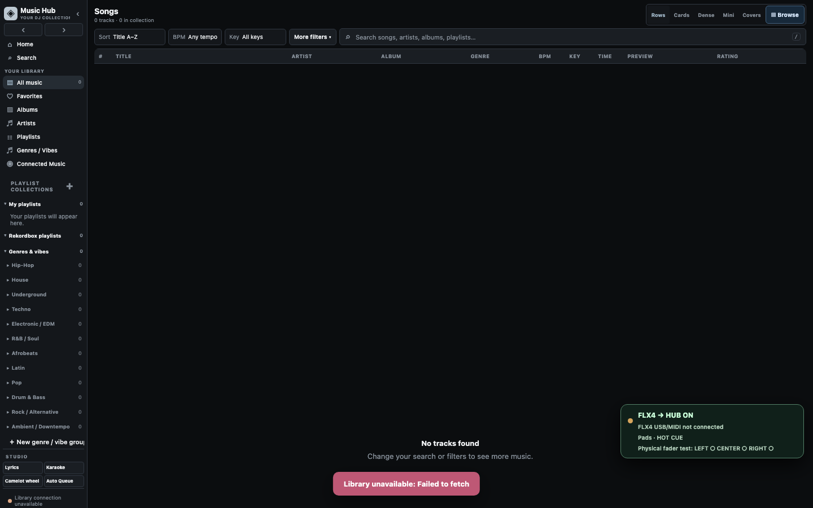
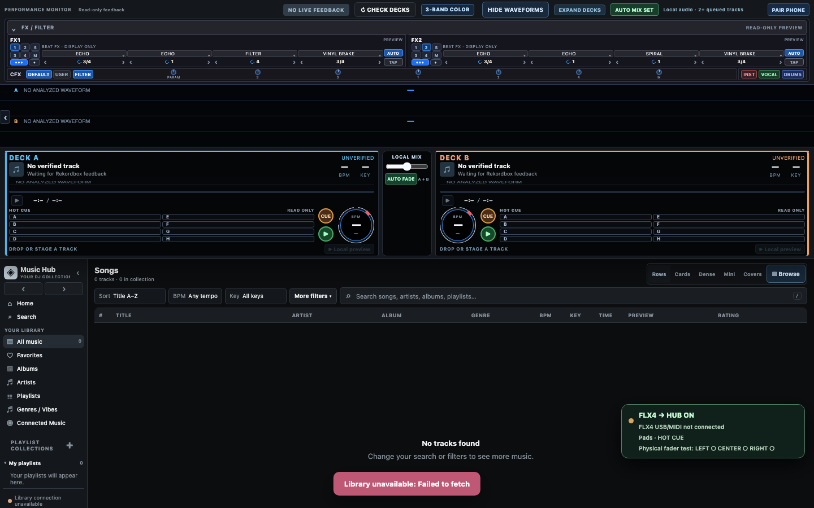
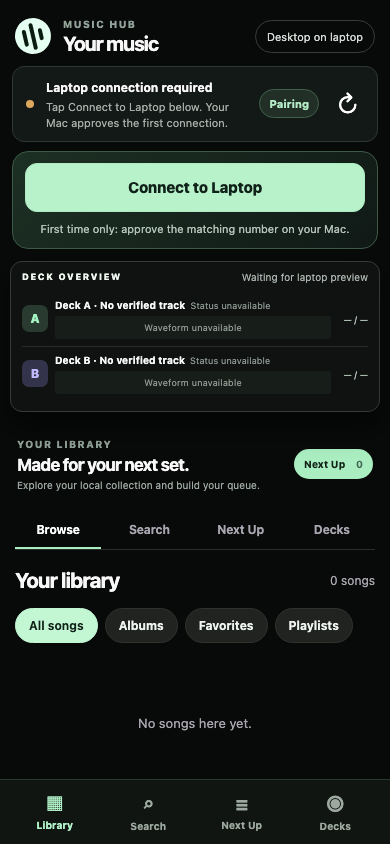
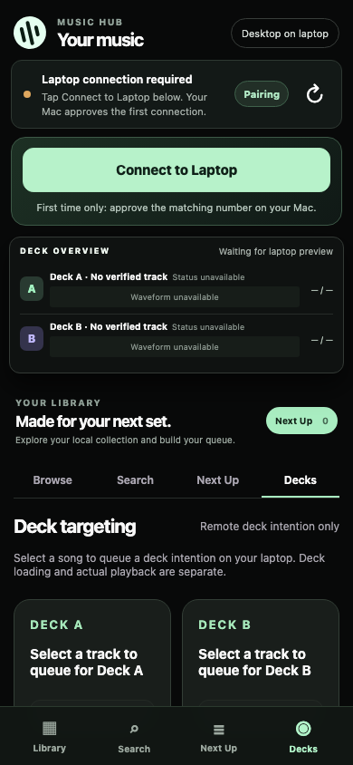

# Music Hub

A local DJ library and performance-planning workspace with a web frontend, Python service components, optional Rust audio modules, and a macOS Swift wrapper.

Music Hub is a **source release for developers**. The UI and its static code can be inspected independently, while music-library integration, installed-app parity and physical controller feedback still require local setup and further verification.

## What is in the source

| Area | Source | Functionality and scope |
| --- | --- | --- |
| Music library | `music-hub/index.html`, `app.js`, `styles.css` | Search, filtering, track lists, playlists, next-up queue, library-health inspection and metadata-based track management. |
| DJ preparation | `harmonic-order.js`, `local-automix.js`, `top-decks-waveform.js`, `performance-chrome.js` | Harmonic ordering, set-list planning, waveform presentation and read-only performance feedback surfaces. These do not establish physical playback control. |
| Instruments and editing | `sampler.js`, `additional-instruments.js`, `stems.js`, `studio.js` | Sampler/stems/studio user interfaces and their associated integration hooks. Compute services and local audio are optional. |
| Connected services | `provider-discovery.js`, `connection-settings.js`, `backend/` | Local backend and service metadata/connectors; authentication and local services must be configured by the developer. |
| Mobile and desktop | `mobile.html`, `mobile.js`, `desktop-remote.js`, `native/MusicHub.swift` | Companion interface, remote-related source, and macOS web-wrapper source. |
| Audio core | `rust/music-hub-core/`, `rust/music-hub-audio/` | Optional Rust crates, requiring a Rust toolchain and platform audio support. |
| Checks | `tests/`, `music-hub/*.test.cjs` | UI/contracts and service tests, including tests that require local integration fixtures. |

## Browse the interface

Open `music-hub/index.html` in a modern browser or serve the directory over localhost, for example:

```sh
cd music-hub
python3 -m http.server 8080
# http://127.0.0.1:8080/
```

The interface may load in disconnected mode; live library lists, accounts, audio and performance feedback require the corresponding local services. The Swift wrapper is configured for a Python server on `127.0.0.1:18769`; inspect `backend/runtime_server.py` and `backend/requirements.txt` before configuring your own machine. Do not assume the wrapper can be packaged directly from this export.

## Developer validation

From this repository root:

```sh
node --check music-hub/app.js
node --check music-hub/sampler.js
node --check music-hub/native-rust-audio.js
node --test music-hub/native-rust-audio.contract.test.cjs
# Optional, if Cargo is available:
cargo test --manifest-path rust/music-hub-core/Cargo.toml
```

Python service tests have environmental prerequisites. See [STATUS.md](STATUS.md) for the staged audit results and known failing tests; a passing frontend syntax check does **not** prove a complete DJ/audio workflow.

## Current limits

- The published source has not been proven to reproduce the currently installed Music Hub app end-to-end.
- External streaming subscriptions are accessed through provider-approved APIs and user accounts; the code does not bundle their audio.
- Rekordbox library paths, hardware routing, live deck events, stem computation, plugin-dependent audio, and native packaging must be configured and independently verified.
- No personal music library, audio, stems, media cache, Rekordbox database, provider tokens, or compiled application is included.

See [third-party notices](THIRD_PARTY_NOTICES.md) for external components and attribution. This project is not affiliated with AlphaTheta, Pioneer DJ, or any music provider.

## UI previews

These are fresh screenshots from the **staged source HTML**, captured in a separate headless Chrome browser at desktop (1440 × 900) and phone (390 × 844) viewport sizes on 2026-11-14. The views use an empty/disconnected local library; there are no user playlists, tracks, audio files or authenticated provider accounts.

### Desktop library: disconnected collection



The desktop library provides navigation, playlist categories, searchable columns and filters. The local API was unavailable during capture; no imported songs or live library synchronization is shown.

### Desktop DJ workspace: unverified performance panels



The staged interface includes dual deck displays, performance preview, mixer layout, and FX/filter controls. All tracks and waveforms are unverified/unavailable; these controls are **UI previews**. Some displayed bridge/status text originates from local frontend state and **does not demonstrate physical FLX4 communication, audio playback or hardware control**.

### Mobile companion: library and pairing



The responsive companion shows phone pairing, an unverified two-deck overview, category chips, and an empty Browse tab. Pairing was not completed and no desktop server connection was established.

### Mobile companion: deck intentions



The Decks tab exposes the two-deck targeting interface and describes its intent queue. This does not establish that a physical deck was loaded or that live feedback was received.

A prior source-browser screenshot is also retained for comparison: [initial disconnected browser preview](docs/screenshots/music-hub-disconnected.png).
